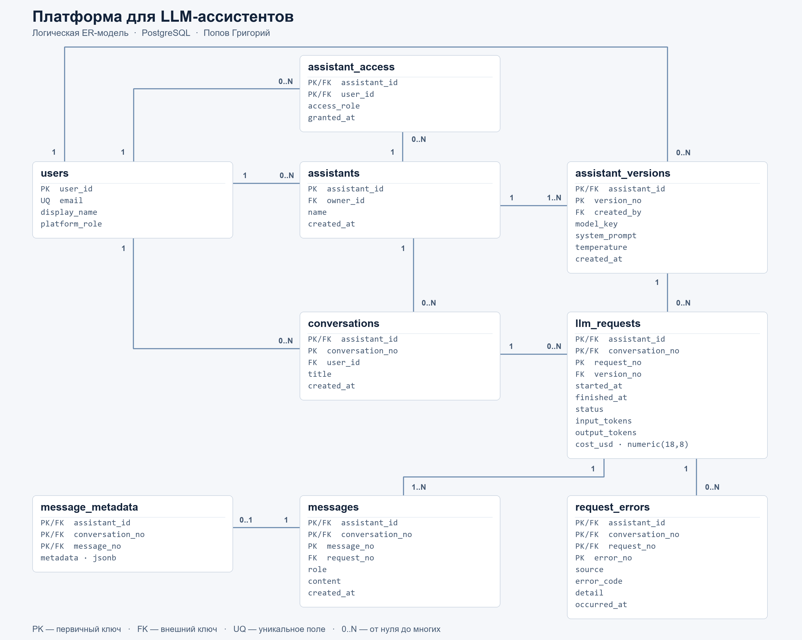

# ER-модель платформы для LLM-ассистентов

Роль 2 · Архитектор данных · Попов Григорий

[Редактируемая диаграмма draw.io](03-llm-platform.drawio)

Модель уточняет [черновой список сущностей](02-rough-db-structure.md) по [требованиям к продукту](01-requirements.md). Запрос связывает версию настроек с сообщениями, расходами и ошибками. Одна строка запроса соответствует одной пользовательской отправке, в том числе если обработка завершилась ошибкой. Внутренние вызовы модели и инструментов могут породить несколько сообщений и ошибок в рамках одного запроса.

## Сущности и ключи

Все поля обязательны, кроме явно помеченных как `NULL`. Идентификаторы и номера имеют тип `bigint`, значения времени — `timestamptz`. Номера положительные. `conversation_no` уникален в пределах ассистента, `request_no` и `message_no` — в пределах диалога, `error_no` — в пределах запроса. В обозначениях `PK` — первичный ключ, `FK` — внешний, `UQ` — уникальный.

| Сущность | Ключи | Остальные поля |
| --- | --- | --- |
| `users` | PK `user_id`, UQ `email` | `email text`, `display_name text`, `platform_role text` (`member`, `admin`) |
| `assistants` | PK `assistant_id`, FK `owner_id → users` | `name text`, `created_at` |
| `assistant_access` | PK `(assistant_id, user_id)`, оба поля — FK в `assistants` и `users` соответственно | `access_role text` (`viewer`, `editor`), `granted_at` |
| `assistant_versions` | PK `(assistant_id, version_no)`, FK `assistant_id → assistants`, FK `created_by → users` | `model_key text`, `system_prompt text`, `temperature numeric(4,3)`, `created_at` |
| `conversations` | PK `(assistant_id, conversation_no)`, FK `assistant_id → assistants`, FK `user_id → users` | `title text NULL`, `created_at` |
| `llm_requests` | PK `(assistant_id, conversation_no, request_no)`, FK `(assistant_id, conversation_no) → conversations`, FK `(assistant_id, version_no) → assistant_versions` | `started_at`, `finished_at NULL`, `status text`, `input_tokens bigint NULL`, `output_tokens bigint NULL`, `cost_usd numeric(18,8) NULL` |
| `messages` | PK `(assistant_id, conversation_no, message_no)`, FK `(assistant_id, conversation_no, request_no) → llm_requests` | `role text` (`user`, `assistant`, `tool`), `content text NULL`, `created_at` |
| `message_metadata` | PK и FK `(assistant_id, conversation_no, message_no) → messages` | `metadata jsonb` |
| `request_errors` | PK `(assistant_id, conversation_no, request_no, error_no)`, FK `(assistant_id, conversation_no, request_no) → llm_requests` | `source text` (`llm`, `tool`), `error_code text`, `detail text NULL`, `occurred_at` |

Поля, указанные в столбце ключей, входят в состав сущности. Текстовые имена, коды и email должны быть непустыми. Email перед записью приводится к нижнему регистру и хранится в канонической форме.

## Ограничения и поведение

- **Доступ.** Владелец хранится в `assistants.owner_id`. Выданные права хранятся в `assistant_access`. Одна пара «ассистент — коллега» имеет одну роль. `viewer` может использовать ассистента, `editor` также может публиковать настройки, владелец управляет доступом. Общий доступ к ассистенту сам по себе не даёт доступ к чужим диалогам. Приложение проверяет роль при операции и выдаёт администратору доступ к аудиту.
- **Версии.** Ассистент и его первая версия создаются одной транзакцией. `temperature` от 0 до 2 включительно, `model_key` хранит идентификатор вида `провайдер/модель`. Опубликованные настройки сохраняются без изменений. Активна версия с наибольшим `version_no`. При публикации блокируется строка ассистента, чтобы два редактора не получили один номер. Возврат к старым настройкам создаёт следующую версию с копией их значений.
- **Аудит.** При отправке запроса приложение записывает выбранный номер версии перед вызовом модели и использует именно эту конфигурацию до конца обработки. Оба FK запроса включают `assistant_id`, поэтому запрос нельзя связать с диалогом или версией другого ассистента. Сообщения наследуют версию через запрос. Редактирование или удаление исторических версий запрещается в рабочем сценарии. Удаление родителей, на которых ссылается история, ограничивается FK.
- **Учёт.** `status` принимает `pending`, `succeeded` или `failed`. У `pending` нет `finished_at`, у завершённого запроса время окончания обязательно и не раньше начала. Токены и стоимость неотрицательны. `NULL` означает, что данные ещё не получены, `0` — подтверждённое отсутствие расхода. Значения фиксируются на запросе в целом, включая повторы вызовов. Для MVP все суммы приведены к USD перед записью и хранятся точным `numeric`.
- **Сообщения.** Одному запросу соответствует одна пользовательская отправка и произвольное количество сообщений ассистента и инструментов. Пользовательское сообщение создаётся вместе с запросом. Для `user` требуется `content`. У ответа, состоящего из вызова инструмента, текст может отсутствовать. Порядок истории задаёт `message_no`.
- **Метаданные.** У сообщения может быть одна строка метаданных. Общий PK/FK исключает дубли. Верхний уровень JSONB — объект. В нём допустимы, например, ключи `tool_calls` и `citations`; структура допускает новые поля без миграции схемы.
- **Ошибки.** Один запрос может породить несколько событий. Для рейтинга хранится отдельный стабильный `error_code`. Ошибка инструмента может быть исправлена в рамках запроса, который в итоге завершится успешно. Для `failed` приложение сохраняет минимум одно событие ошибки в транзакции завершения.

PK, FK, уникальность, допустимые значения полей и форма JSONB реализуются ограничениями PostgreSQL. Правила, которым нужно проверить несколько таблиц или несколько строк, относятся к транзакциям приложения или процедур БД. К ним относятся публикация версии, проверка доступа, одна пользовательская отправка и наличие ошибки у `failed`.

## Нормализация

Реляционная часть проектируется в **третьей нормальной форме**. Данные пользователя хранятся в `users`, название и владелец ассистента — в `assistants`, конфигурация — в `assistant_versions`. Владелец диалога определяется его полным ключом и хранится только в `conversations`. Статус, расход и версия запроса определяются полным ключом запроса и записываются один раз. Сообщение содержит содержимое и ссылку на запрос. Составные ключи выражают область уникальности номера и позволяют проверять принадлежность одному ассистенту стандартными FK.

Связь многие-ко-многим между пользователями и ассистентами вынесена в `assistant_access`, где роль зависит от обоих ключей. JSONB выделен в необязательную зависимую сущность для данных переменной структуры. Ключи связей и поля для сводных отчётов остаются обычными столбцами. Активная версия и сводные расходы вычисляются по исходным данным.

## Как модель покрывает требования

| Требование | Где брать данные |
| --- | --- |
| F-01–F-05. Настройка, список, общий доступ и история | `assistants`, `assistant_access`, `assistant_versions` |
| F-06–F-07. Диалоги, сообщения и сведения о расходе | `conversations → llm_requests → messages`. Токены и сумма видны рядом с сообщением через запрос |
| F-08. Вызовы инструментов и цитаты | `message_metadata.metadata` |
| F-09. Настройки, использованные при обработке | `llm_requests → assistant_versions` по номеру версии в рамках ассистента |
| F-10. Стоимость и количество запросов | Период `[from, to)` по `llm_requests.started_at`. Сумма по строкам запросов: общая, по `assistant_id` или по владельцу диалога из `conversations`. Количество — по запросам, включая неудачные. Запросы с неизвестной стоимостью считаются отдельно |
| F-10–F-11. Топ и детали ошибок | Период по `request_errors.occurred_at`. Счётчик событий по паре `(source, error_code)`, сортировка по убыванию. Связь с `llm_requests` даёт версию и диалог даже при отсутствии ответа |

Например, если запрос с версией 4 вернул ответ и записал ещё два сообщения инструмента, его стоимость учитывается один раз. После публикации версии 5 ссылка этого запроса по-прежнему ведёт к версии 4.
